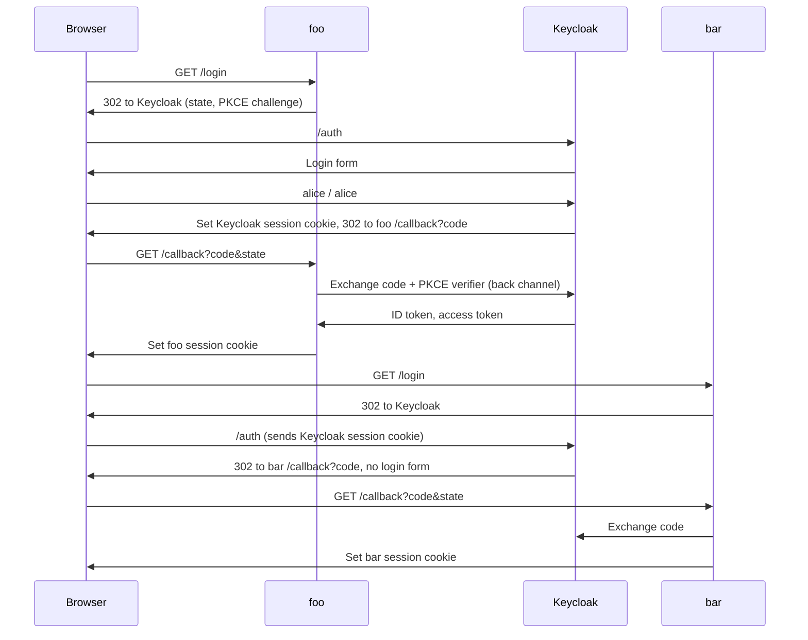

# SSO Lab: Keycloak + Go

A minimal single sign-on lab. One user logs in once and is signed in to two
separate apps, `foo` and `bar`, using OpenID Connect (OIDC) with Keycloak as
the identity provider (IdP).

| Component | URL | Notes |
|-----------|-----|-------|
| Keycloak (IdP) | http://localhost:8080 | Admin console: `admin` / `admin` |
| foo (app) | http://foo.localhost:3001 | OIDC client `foo` |
| bar (app) | http://bar.localhost:3002 | OIDC client `bar` |

Test user: `alice` / `alice`.

## Prerequisites

- Docker (Docker Desktop must be running)
- Go 1.25+ (the module requires Go 1.26; Go downloads that toolchain automatically)
- Chrome or curl. These resolve `*.localhost` to `127.0.0.1` without setup. For
  Safari, add this line to `/etc/hosts`:

  ```text
  127.0.0.1 foo.localhost bar.localhost
  ```

## Quick start

Use three terminals:

```bash
make up    # start Keycloak, imports keycloak/realm.json
make foo   # http://foo.localhost:3001
make bar   # http://bar.localhost:3002
```

1. Open http://foo.localhost:3001, click **Login with SSO**, and sign in as
   `alice` / `alice`.
2. Click **Go to the other app**, then **Login with SSO** on bar. You are
   logged in without a password prompt. That is SSO.

Stop Keycloak with `make down`.

## Project layout

```text
docker-compose.yml   Keycloak 26 in dev mode, imports the realm on start
keycloak/realm.json  Realm "lab": user alice, clients foo and bar
app/main.go          OIDC relying party (one binary, run twice)
Makefile             up, down, foo, bar
```

## How it works

foo and bar are on different hostnames, so they cannot read each other's
cookies. The only shared state is Keycloak's own session cookie on
`localhost:8080`.



The parts of `app/main.go` worth reading:

- **Discovery:** `oidc.NewProvider` reads
  `/.well-known/openid-configuration` to find the endpoints and signing keys.
- **`/login`:** redirects to Keycloak with a `state` value (protects against
  cross-site request forgery) and a PKCE challenge (stops a stolen code being
  used).
- **`/callback`:** checks `state`, exchanges the code server to server, then
  verifies the ID token's signature, issuer, audience and expiry before
  trusting any claim.
- **`/logout`:** clears the app session and calls Keycloak's
  `end_session_endpoint` (RP-initiated logout).

Each app keeps its own session after login. SSO only saves you typing the
password again; it does not share sessions between apps.

## Things to try

- **Single logout gap:** log out on foo, then reload bar. Bar still shows you
  as logged in, because logout only ended foo's session and Keycloak's.
  Implementing front-channel or back-channel logout fixes this.
- **Sessions in the IdP:** open the Keycloak admin console, go to realm `lab`
  and then **Sessions**. Alice has one session used by two clients.
- **Token contents:** read the ID token claims shown on the app page.
- **Another user:** add a user in the admin console and log in to both apps.
- **Another IdP:** register two clients in Auth0, Okta or Cognito with the same
  redirect URIs, then run the app with `-issuer`, `-name` and `-secret`. The Go
  code stays the same.

## Troubleshooting

| Symptom | Cause | Fix |
|---------|-------|-----|
| `invalid state: login cookies missing` | Login started on another hostname, or you stayed on the login page for more than 5 minutes | Start from `http://foo.localhost:3001`. Other hostnames now redirect there automatically |
| `invalid state: mismatch` | A second login started in another tab | Retry from `/login` |
| `discover issuer` on app start | Keycloak is not ready yet | Wait for `make up` to finish starting, then rerun |
| `Cannot connect to the Docker daemon` | Docker Desktop is not running | `open -a Docker` |
| `redirect_uri` error from Keycloak | Redirect URI does not match `realm.json` | Keep the hostnames and ports shown above |

## Lab shortcuts

These are deliberate simplifications. Do not reuse them outside the lab.

- Plain HTTP instead of HTTPS.
- Keycloak in dev mode with an in-container database. Realm changes made in
  the admin console are lost when the container is removed.
- App sessions are kept in memory and lost on restart.
- Dummy client secrets and passwords committed in `realm.json` and `Makefile`.
