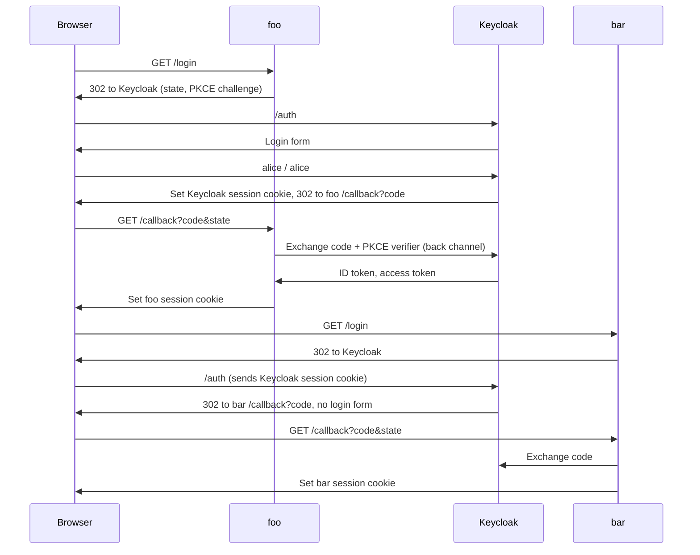
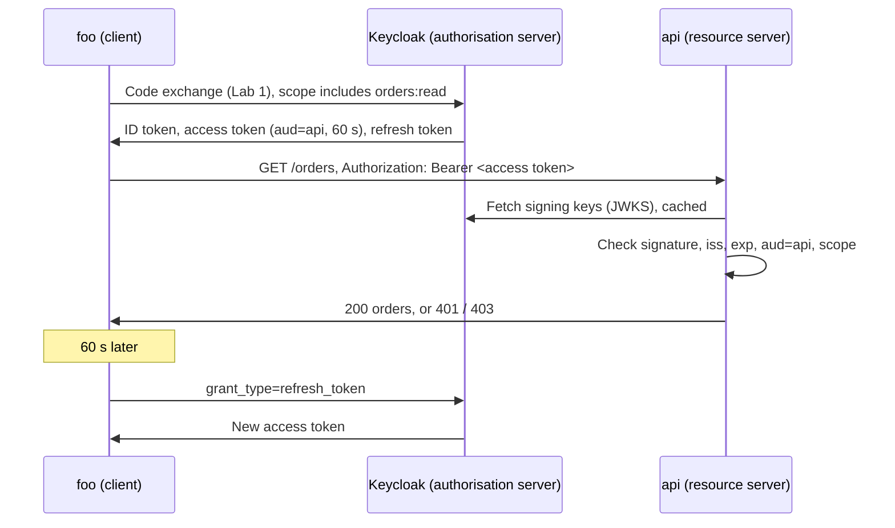

# SSO Lab: Keycloak + Go

A minimal single sign-on lab. One user logs in once and is signed in to two
separate apps, `foo` and `bar`, using OpenID Connect (OIDC) with Keycloak as
the identity provider (IdP).

| Component | URL | Notes |
|-----------|-----|-------|
| Keycloak (IdP) | http://localhost:8080 | Admin console: `admin` / `admin` |
| foo (app) | http://foo.localhost:3001 | OIDC client `foo` |
| bar (app) | http://bar.localhost:3002 | OIDC client `bar` |
| api (resource server) | http://localhost:4000 | Access token lab, see [Lab 2](#lab-2-access-tokens-oauth2) |

Test user: `alice` / `alice`.

## Prerequisites

- Docker (Docker Desktop must be running)
- `jq` for `make m2m` (`brew install jq`)
- Go 1.25+ (the module requires Go 1.26; Go downloads that toolchain automatically)
- Chrome or curl. These resolve `*.localhost` to `127.0.0.1` without setup. For
  Safari, add this line to `/etc/hosts`:

  ```text
  127.0.0.1 foo.localhost bar.localhost
  ```

## Quick start

Use three terminals:

```bash
make up    # start Keycloak, imports keycloak/realm.json
make foo   # http://foo.localhost:3001
make bar   # http://bar.localhost:3002
```

1. Open http://foo.localhost:3001, click **Login with SSO**, and sign in as
   `alice` / `alice`.
2. Click **Go to the other app**, then **Login with SSO** on bar. You are
   logged in without a password prompt. That is SSO.

Stop Keycloak with `make down`.

## Project layout

```text
docker-compose.yml   Keycloak 26 in dev mode, imports the realm on start
keycloak/realm.json  Realm "lab": user alice, clients foo and bar
app/main.go          OIDC relying party (one binary, run twice)
app/api/main.go      OAuth2 resource server that validates access tokens
Makefile             up, down, foo, bar, api, m2m
```

## How it works

foo and bar are on different hostnames, so they cannot read each other's
cookies. The only shared state is Keycloak's own session cookie on
`localhost:8080`.



The parts of `app/main.go` worth reading:

- **Discovery:** `oidc.NewProvider` reads
  `/.well-known/openid-configuration` to find the endpoints and signing keys.
- **`/login`:** redirects to Keycloak with a `state` value (protects against
  cross-site request forgery) and a PKCE challenge (stops a stolen code being
  used).
- **`/callback`:** checks `state`, exchanges the code server to server, then
  verifies the ID token's signature, issuer, audience and expiry before
  trusting any claim.
- **`/logout`:** clears the app session and calls Keycloak's
  `end_session_endpoint` (RP-initiated logout).

Each app keeps its own session after login. SSO only saves you typing the
password again; it does not share sessions between apps.

## Things to try

- **Single logout gap:** log out on foo, then reload bar. Bar still shows you
  as logged in, because logout only ended foo's session and Keycloak's.
  Implementing front-channel or back-channel logout fixes this.
- **Sessions in the IdP:** open the Keycloak admin console, go to realm `lab`
  and then **Sessions**. Alice has one session used by two clients.
- **Token contents:** read the ID token claims shown on the app page.
- **Another user:** add a user in the admin console and log in to both apps.
- **Another IdP:** register two clients in Auth0, Okta or Cognito with the same
  redirect URIs, then run the app with `-issuer`, `-name` and `-secret`. The Go
  code stays the same.

## Lab 2: Access tokens (OAuth2)

Lab 1 used the ID token, which tells the app who logged in. This lab uses the
access token, which lets the app call an API on the user's behalf.

| | ID token (OIDC) | Access token (OAuth2) |
|---|---|---|
| Audience (`aud`) | The client (`foo`) | The API (`api`) |
| Who reads it | The client | The resource server (API) only. The client treats it as opaque |
| Answers | Who the user is | What the bearer may do (`scope`) |
| Sent to an API? | Never | Yes, as `Authorization: Bearer <token>` |
| Lifetime | Checked once at login; the app keeps its own session | 60 s for foo, renewed with the refresh token |

### Run it

Use four terminals:

```bash
make down && make up   # restart so Keycloak re-imports the updated realm
make api               # http://localhost:4000
make foo
make bar
```

1. Log in on foo. The page now shows the ID token claims and, below them, the
   access token claims. Compare `aud` (`foo` against `api`) and `typ` (`ID`
   against `Bearer`).
2. Click **GET /orders**. foo sends the access token, and the API returns
   alice's orders with `200`.
3. Click **POST /orders**. The API returns `403 insufficient_scope`: foo's
   token has `orders:read` but not `orders:write`. Authentication worked;
   authorisation did not.
4. Wait about a minute and click **GET /orders** again. The page shows
   `Access token refreshed: true`. foo used its refresh token to get a new
   access token without a login redirect.
5. On bar, click **GET /orders**. The API returns `401`: bar never requested
   `orders:read`, so its token has no `api` audience. The API refuses it even
   though alice is the same user.
6. Run `make m2m`. The `reporter` service uses the **client credentials**
   grant. It authenticates as itself, with no user and no browser, and the
   caller shown is `service-account-reporter`.

### How it fits together



The parts worth reading:

- **`keycloak/realm.json`:** client scopes `orders:read` and `orders:write`.
  Each one adds `api` to the token's `aud` through an audience mapper. foo
  lists both as `optionalClientScopes`, so it may have either, but gets one
  only when it asks. The `Makefile` passes `-scopes orders:read`, so foo's
  token has `orders:read` and not `orders:write`. bar lists neither, so it
  can never get them. `reporter` is a service-account client allowed
  `orders:read`.
- **`app/api/main.go`, `require`:** reads the bearer token, verifies it
  locally against Keycloak's JWKS (no call to Keycloak per request), then
  checks the route's scope. Errors follow RFC 6750: `401 invalid_token` for
  a missing or bad token, `403 insufficient_scope` for a valid token that
  lacks the scope.
- **`app/main.go`, `/call-api`:** `conf.TokenSource(...).Token()` returns the
  stored token, or refreshes it when it is within 10 s of expiry. The app then
  saves the new token in the session.

### Things to try

- **Call the API yourself:**

  ```bash
  TOKEN=$(curl -s -d grant_type=client_credentials -d client_id=reporter \
    -d client_secret=reporter-secret -d scope=orders:read \
    http://localhost:8080/realms/lab/protocol/openid-connect/token | jq -r .access_token)
  curl -s -H "Authorization: Bearer $TOKEN" http://localhost:4000/orders
  curl -s -X POST -H "Authorization: Bearer $TOKEN" http://localhost:4000/orders   # 403
  curl -s -H "Authorization: Bearer ${TOKEN%?}x" http://localhost:4000/orders     # 401, bad signature
  ```

- **Drop the scope:** request a token without `-d scope=orders:read`. The
  `aud` claim no longer includes `api`, so the API returns `401`.
- **Revocation gap:** log in on foo, then end alice's session in the admin
  console (realm `lab`, then **Sessions**). The current access token still
  works until it expires, because the API checks it locally. The next refresh
  fails. Short lifetimes keep this window small; token introspection
  (RFC 7662) closes it at the cost of a call to Keycloak per request.
- **Grant write access:** add `orders:write` to foo's `-scopes` in the
  `Makefile`, restart foo, log in again and retry **POST /orders**.

## Troubleshooting

| Symptom | Cause | Fix |
|---------|-------|-----|
| `invalid state: login cookies missing` | Login started on another hostname, or you stayed on the login page for more than 5 minutes | Start from `http://foo.localhost:3001`. Other hostnames now redirect there automatically |
| `invalid state: mismatch` | A second login started in another tab | Retry from `/login` |
| `discover issuer` on app start | Keycloak is not ready yet | Wait for `make up` to finish starting, then rerun |
| `Cannot connect to the Docker daemon` | Docker Desktop is not running | `open -a Docker` |
| `IdP returned invalid_scope` | Keycloak is still running the old realm | `make down && make up` |
| `api unreachable` on **GET /orders** | The API is not running | `make api` |
| `make m2m` prints `parse error` or `null` | Keycloak or the API is not running, or `jq` is missing | Start both; install `jq` with `brew install jq` |
| `redirect_uri` error from Keycloak | Redirect URI does not match `realm.json` | Keep the hostnames and ports shown above |

## Lab shortcuts

These are deliberate simplifications. Do not reuse them outside the lab.

- Plain HTTP instead of HTTPS.
- Keycloak in dev mode with an in-container database. Realm changes made in
  the admin console are lost when the container is removed.
- App sessions, including access and refresh tokens, are kept in memory and
  lost on restart. Real apps store refresh tokens encrypted.
- Dummy client secrets and passwords committed in `realm.json` and `Makefile`.
